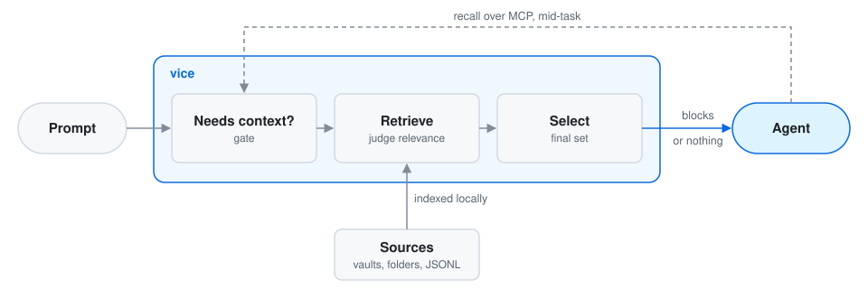

# vice

A context retrieval engine for AI agents.

> [!WARNING]
> vice is a work in progress. Interfaces, configuration and output formats may change
> without notice. macOS only.

vice takes information retrieval over your own knowledge off the agent. It decides
whether a prompt needs context, finds and reads the relevant sources, and resolves
conflicting or outdated information. Relevant context is pushed to the agent before it
processes the prompt, and is also available on demand over MCP. The agent's context
window holds the result, not the search.

<picture>
  <source media="(prefers-color-scheme: dark)" srcset="docs/assets/flow-dark.svg">
  
</picture>

For the prompt `draft the Atlas launch announcement`, the agent receives:

```text
Relevant information from the user's sources (vice):
[2026-10-20] Atlas launches December 2.
[2026-11-03] Atlas messaging: lead with offline sync; pricing is unchanged.
```

A prompt that needs no context adds nothing.

Relevance and contradiction judgments come from TypeSafe's
[Jev](https://docs.typesafe.ai), which returns calibrated probabilities for typed
questions. Retrieval, thresholds and decisions are deterministic code.

## Features

- Source types so far: Obsidian vaults, Markdown folders, and JSONL, which any other
  system can export blocks to. Further types install as separate packages
  ([Sources](docs/sources.md))
- Claude Code integration in one command: context arrives with the prompt, and the agent
  cannot read indexed files directly
- MCP server for lookups mid-task, for Claude Code, Claude Desktop and other stdio clients
- `vice ask` for scripts
- Outputs: context file, command, webhook

## Benchmark

Synthetic dataset, held-out test split: 150 events over 1,500 blocks, `jev-1.14.0`.

| Measure | Result |
|---|---|
| Acted when no context was needed | 0 of 60 |
| Missed when context was needed | 2 of 90 |
| Context precision / recall | 0.896 / 0.906 |
| Superseded fact included | 6.8% |
| Latency | 210 ms p50, 404 ms p95 |
| Cost per event | ~4,500 input tokens, ~$0.0002 |

Method, ablations and limits: [Evaluation](docs/evaluation.md).

## Documentation

- [Installation](docs/installation.md)
- [Usage](docs/usage.md)
- [Configuration](docs/configuration.md)
- [Sources](docs/sources.md)
- [Integrations](docs/integrations.md)
- [Privacy](docs/privacy.md)
- [Troubleshooting](docs/troubleshooting.md)
- [Evaluation](docs/evaluation.md)
- [Contributing](CONTRIBUTING.md)

## Privacy

Sources are indexed and searched locally. Event text and about 20 candidate blocks per
event are sent to TypeSafe's API, after credential redaction. See
[Privacy](docs/privacy.md).

## License

MIT
