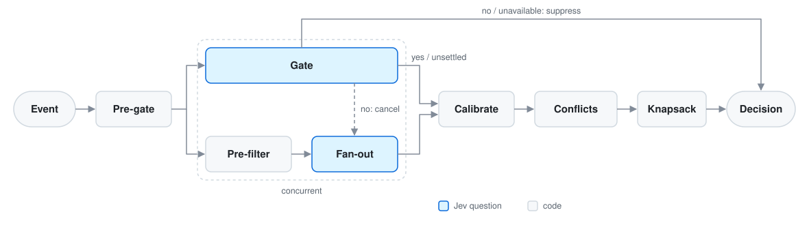

# Evaluation and architecture

## Pipeline

<picture>
  <source media="(prefers-color-scheme: dark)" srcset="assets/pipeline-dark.svg">
  
</picture>

| Stage | File | |
|---|---|---|
| Pre-gate | `pregate.py` | Length bounds, deduplication, secret masking. |
| Gate | `gate.py` | Two Nouls (names something specific; depends on a missing detail), combined and banded into yes / no / unsettled. Timeout or failure suppresses. |
| Pre-filter | `retrieve.py` | MiniLM embeddings fused with BM25, exact search, top 20. |
| Fan-out | `fanout.py` | One request, sent before the gate answers: a relevance Choice per candidate and a conflict Noul per similar pair. Cancelled on gate no. |
| Calibration | `calibrate.py` | Logistic model over the gate Nouls; isotonic map for relevance. |
| Conflict resolution | `conflict.py` | Jev judges disagreement; code orders by date. The older block's value halves per 14 days of gap and is dropped below the relevance floor. |
| Packing | `pack.py` | 0/1 knapsack over the token budget. |
| Decision | `decide.py` | Truth table over gate status and packed context. |

Wording sent to Jev: `questions.py`. Numbers: `config.py` and `default_calibration.json`.

## Results

Synthetic dataset, held-out test split: 150 events (90 need retrieval) over 1,500 blocks,
live `jev-1.14.0`, thresholds fitted on a separate calibration split.

| Measure | Result |
|---|---|
| Intrusion (acted, nothing warranted) | 0 of 60 |
| Miss (silent, context needed) | 2 of 90 |
| Context precision / recall | 0.896 / 0.906 |
| Context exactly right | 77.8% |
| Superseded fact included | 6.8% |
| Latency | 210 ms p50, 404 ms p95 |
| Input tokens per event | ~4,500 (~$0.0002) |

Gate requests measured 162 ms p50 and 195 ms p95; the budget is 300 ms. The gate runs
concurrently with the fan-out. The p95 comes from a follow-up conflict request, needed in
30 of 90 retrievals.

Calibration choices (calibration split):

| Choice | Evidence |
|---|---|
| Relevance primitive: Choice | AP 0.968; Noul 0.943, Score 0.872 |
| Fan-out: one request | AP 0.968; per-candidate requests 0.969 |
| Relevance calibration | ECE 0.022 raw, 0.005 isotonic |
| Gate | Separated all 150 events |

Ablations (test split, replayed):

| Variant | Miss | Precision | Recall | Stale fact |
|---|---|---|---|---|
| Full pipeline | 2.2% | 0.896 | 0.906 | 6.8% |
| No conflict resolution | 1.1% | 0.677 | 0.939 | 48.3% |
| Uncalibrated 0.7 / 0.3 thresholds | 4.4% | 0.869 | 0.906 | 12.8% |

Pre-filter (calibration split, recall of required blocks, with BM25 fusion):

| Embedder | Recall@12 | Recall@20 | Query p95 |
|---|---|---|---|
| all-MiniLM-L6-v2 | 0.939 | 0.989 | 3.9 ms |
| nomic-embed-text-v1.5 | 0.922 | 0.983 | 23.1 ms |
| potion-base-8M | 0.828 | 0.989 | 0.08 ms |
| bge-small-en-v1.5 | 0.867 | 0.917 | 6.7 ms |

Raw reports: `reports/`.

## Limits

- The data is synthetic and templated; the gate separated it perfectly. Expect a
  non-zero intrusion rate on real traffic.
- Test blocks are single sentences. Real Markdown blocks are paragraphs with a title
  prefix; thresholds are not validated on that shape.
- 0 of 60 intrusions is consistent with a true rate up to about 5%.
- Miss rate varied from 1.1% to 3.3% across identical live runs.
- Latency was measured from one machine and network.
- Events mimic copied text, dropped files and typed questions, not agent prompts.

## Running the harness

`TYPESAFE_API_KEY` in `.env` at the repository root.

```bash
pip install -e ".[mcp,eval,dev]"
```

```bash
python -m vice_ai.eval.dataset
```

```bash
python -m vice_ai.eval.prefilter
```

```bash
python -m vice_ai.eval.latency
```

```bash
python -m vice_ai.eval.calibrate
```

```bash
python -m vice_ai.eval.e2e
```

`dataset` regenerates the seeded golden set. `prefilter` is local. `latency`,
`calibrate` and `e2e` call Jev, about 4M input tokens (~$0.17) together. `calibrate`
rewrites `src/vice_ai/default_calibration.json`.

## Recalibrating

Calibration is pinned to `jev-1.14.0`; loading it with another model is an error.
`~/.vice/calibration.json` overrides the shipped file. There is no command yet to fit
one from labelled user decisions.
